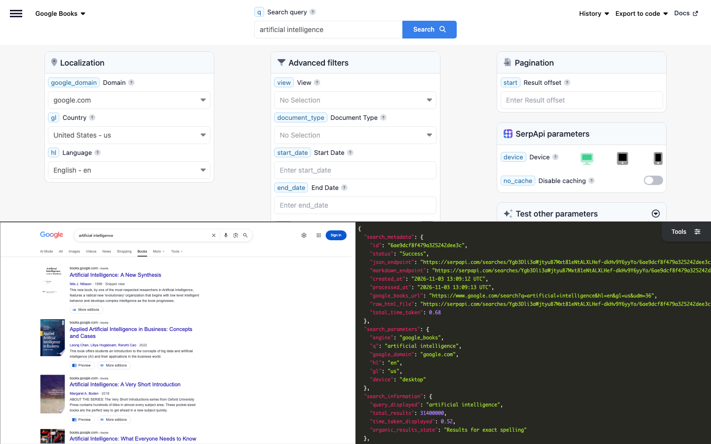

# Google Books Scraper

Scrape Google Books with SerpApi's Google Books API. Search books, magazines, and scanned newspapers, and get each result's title, link, Google Books ID, thumbnail, authors, publication date, snippet, availability, and other editions.

## How to scrape Google Books

Search Google Books with a simple GET request:

```text
https://serpapi.com/search?engine=google_books&q=artificial+intelligence&api_key=SERPAPI_API_KEY
```

- `q` is the search query: a title, an author, a subject, or a quote. Search operators such as `intitle:`, `inauthor:`, `inpublisher:`, `subject:`, and `isbn:` work too.
- `api_key` is your SerpApi API key. Replace `SERPAPI_API_KEY` with it.
- `document_type` limits the results to `books`, `magazines`, or `newspapers` from the Google News Archive.
- `view` only shows books with a `preview` or a `full` view.
- `start_date` and `end_date` limit the results to a publication period, in `YYYYMMDD` format.
- `start` skips results for pagination. Each page has up to 10 results.

[Register at SerpApi](https://serpapi.com?utm_source=github_google_books_scraper) to get your API key, and keep it private.

### Playground

Try the request live in the [SerpApi Playground](https://serpapi.com/playground?engine=google_books&q=artificial+intelligence&utm_source=github_google_books_scraper).

[](https://serpapi.com/playground?engine=google_books&q=artificial+intelligence&utm_source=github_google_books_scraper)

## Code examples

The code examples read your API key from the `SERPAPI_API_KEY` environment variable:

```bash
export SERPAPI_API_KEY="SERPAPI_API_KEY"
```

Each example searches Google Books for “artificial intelligence” and prints the position, title, and link of each result on the first page.

### curl integration

Send the request with curl, which prints the full JSON response:

```bash
curl --get https://serpapi.com/search \
 --data-urlencode engine="google_books" \
 --data-urlencode q="artificial intelligence" \
 --data-urlencode api_key="$SERPAPI_API_KEY"
```

### JavaScript integration

Install the [SerpApi JavaScript library](https://github.com/serpapi/serpapi-javascript) and set your project to use ES modules:

```bash
npm install serpapi
npm pkg set type=module
```

Create an `index.js` file:

```javascript
import { getJson } from "serpapi";

const results = await getJson({
  engine: "google_books",
  api_key: process.env.SERPAPI_API_KEY,
  q: "artificial intelligence",
});

for (const result of results.organic_results ?? []) {
  console.log(result.position, result.title, result.link);
}
```

Run it with `node index.js`.

### Python integration

Install the [SerpApi Python library](https://github.com/serpapi/serpapi-python):

```bash
pip install serpapi
```

Create a `main.py` file:

```python
import os
import serpapi

client = serpapi.Client(api_key=os.getenv("SERPAPI_API_KEY"))
results = client.search({
    "engine": "google_books",
    "q": "artificial intelligence",
})

for result in results.get("organic_results", []):
    print(result["position"], result["title"], result["link"])
```

Run it with `python main.py`.

### Ruby integration

Install the [SerpApi Ruby library](https://github.com/serpapi/serpapi-ruby):

```bash
gem install serpapi
```

Create a `main.rb` file:

```ruby
require "serpapi"

client = SerpApi::Client.new(engine: "google_books", api_key: ENV.fetch("SERPAPI_API_KEY"))
results = client.search(q: "artificial intelligence")

results.fetch(:organic_results, []).each do |result|
  puts "#{result[:position]} #{result[:title]} #{result[:link]}"
end

client.close
```

Run it with `ruby main.rb`.

### PHP integration

Install the [SerpApi PHP library](https://github.com/serpapi/serpapi-php):

```bash
composer require serpapi/serpapi-php
```

Create an `index.php` file:

```php
<?php
require 'vendor/autoload.php';

use SerpApi\Client;

$client = new Client(getenv('SERPAPI_API_KEY'), 'google_books');
$results = $client->search([
  'q' => 'artificial intelligence',
]);

foreach ($results->organic_results ?? [] as $result) {
  echo $result->position . ' ' . $result->title . ' ' . $result->link . PHP_EOL;
}
```

Run it with `php index.php`.

### Go integration

Create a Go module and install the [SerpApi Go library](https://github.com/serpapi/serpapi-golang):

```bash
go mod init example.com/books
go get github.com/serpapi/serpapi-golang
```

Create a `main.go` file:

```go
package main

import (
	"fmt"
	"os"

	"github.com/serpapi/serpapi-golang"
)

func main() {
	setting := serpapi.NewSerpApiClientSetting(os.Getenv("SERPAPI_API_KEY"))
	setting.Engine = "google_books"
	client := serpapi.NewClient(setting)

	results, err := client.Search(map[string]string{
		"q": "artificial intelligence",
	})
	if err != nil {
		panic(err)
	}

	organicResults, _ := results["organic_results"].([]interface{})
	for _, item := range organicResults {
		result := item.(map[string]interface{})
		fmt.Println(result["position"], result["title"], result["link"])
	}
}
```

Run it with `go run .`.

### Rust integration

Create a Cargo project and add the [SerpApi Rust library](https://github.com/serpapi/serpapi-rust) and Tokio:

```bash
cargo new books && cd books
cargo add serpapi tokio --features tokio/full
```

Replace `src/main.rs` with:

```rust
use serpapi::serpapi::Client;
use std::collections::HashMap;
use std::env;

#[tokio::main]
async fn main() -> Result<(), Box<dyn std::error::Error>> {
    let mut default = HashMap::new();
    default.insert("api_key".to_string(), env::var("SERPAPI_API_KEY")?);
    default.insert("engine".to_string(), "google_books".to_string());
    let client = Client::new(default)?;

    let mut parameter = HashMap::new();
    parameter.insert("q".to_string(), "artificial intelligence".to_string());

    let results = client.search(parameter).await?;
    if let Some(organic_results) = results["organic_results"].as_array() {
        for result in organic_results {
            println!(
                "{} {} {}",
                result["position"],
                result["title"].as_str().unwrap_or_default(),
                result["link"].as_str().unwrap_or_default()
            );
        }
    }
    Ok(())
}
```

Run it with `cargo run`.

### Other programming languages

Official libraries are also available for [Java](https://github.com/serpapi/serpapi-java), [.NET](https://github.com/serpapi/serpapi-dotnet), [Swift](https://github.com/serpapi/serpapi-swift), and [C++](https://github.com/serpapi/serpapi-cpp). See [SerpApi integrations](https://serpapi.com/integrations?utm_source=github_google_books_scraper) for setup guides, or use a simple GET request from any programming language.

### Errors

Failed requests return an HTTP error status and a JSON body with an `error` message. The most common are `401` for an invalid API key, `400` for a missing required parameter such as `q`, and `429` when you exceed your hourly throughput limit or run out of searches. See [API status and error codes](https://serpapi.com/api-status-and-error-codes?utm_source=github_google_books_scraper) for the full list.

## Output formats: JSON and Markdown

Choose structured JSON for applications or Markdown for LLMs and AI agents:

- JSON is the default output and is useful when you need individual result fields.
- Add `output=md` to receive Markdown instead, which is more token-efficient.

Markdown is plain text, not JSON: YAML front matter with the search metadata, followed by tables of the results and links to the next pages. Read the response body as text instead of parsing it.

| Client | Markdown request |
|--------|------------------|
| curl | `--data-urlencode output="md"` |
| Python | `client.search({..., "output": "md"})` |
| PHP | `$client->md([...])` |
| Rust | `client.md(parameter).await?` |

If your SDK doesn't have a Markdown helper yet, send a plain HTTP request with `output=md` and read the body as text. Learn more about [Markdown output](https://serpapi.com/markdown-output?utm_source=github_google_books_scraper).

## Google Books API parameters

See the [Google Books API documentation](https://serpapi.com/google-books-api?utm_source=github_google_books_scraper) for more details.

| Name | Description | Requirement |
|------|-------------|-------------|
| **Search query** | | |
| `q` | The search query: anything you'd use in a regular Google Books search, such as a title, an author, a subject, or a quote. Search operators such as `intitle:`, `inauthor:`, `inpublisher:`, `subject:`, and `isbn:` are supported (e.g., `inauthor:"Stephen King"`). | Required |
| **Localization** | | |
| `google_domain` | The Google domain to use. Defaults to `google.com`. See [Google domains](https://serpapi.com/google-domains?utm_source=github_google_books_scraper) for supported domains. | Optional |
| `gl` | The country to search from, as a two-letter country code (e.g., `us`, `uk`, `fr`). Defaults to `us`. See [Google countries](https://serpapi.com/google-countries?utm_source=github_google_books_scraper) for supported countries. | Optional |
| `hl` | The language to search in, as a two-letter language code (e.g., `en`, `es`, `fr`). Defaults to `en`. See [Google languages](https://serpapi.com/google-languages?utm_source=github_google_books_scraper) for supported languages. | Optional |
| **Advanced filters** | | |
| `view` | How much of the books must be viewable: `preview` for preview and full view, or `full` for full view only. Defaults to any view. | Optional |
| `document_type` | The type of documents to search: `books`, `magazines`, or `newspapers` for the scanned newspapers of the Google News Archive. Defaults to any document. | Optional |
| `start_date` | The earliest publication date, in `YYYYMMDD` format (e.g., `19690701`). Overrides the `cdr` and `cd_min` components of `tbs`. | Optional |
| `end_date` | The latest publication date, in `YYYYMMDD` format (e.g., `19690731`). Overrides the `cdr` and `cd_max` components of `tbs`. | Optional |
| `nfpr` | Set to `1` to exclude results from an auto-corrected query when the original query is misspelled, or `0` to include them (default). Google may still return auto-corrected results when no other results are available. | Optional |
| `tbs` | Advanced search parameters that aren't possible in the query field (e.g., `bkt:s` for newspapers). `view`, `document_type`, `start_date`, and `end_date` override the matching components. | Optional |
| **Pagination** | | |
| `start` | The result offset (e.g., `0` for the first page, `10` for the second, `20` for the third). Defaults to `0`. | Optional |
| **SerpApi parameters** | | |
| `engine` | Set to `google_books`. | Required |
| `api_key` | Your private SerpApi API key. | Required |
| `device` | Set to `desktop` (default), `tablet`, or `mobile`. | Optional |
| `no_cache` | Set to `true` to request fresh results instead of using the one-hour cache. Can't be combined with `async`. | Optional |
| `async` | Set to `true` for later retrieval through the [Searches Archive API](https://serpapi.com/search-archive-api?utm_source=github_google_books_scraper). Can't be combined with `no_cache` or used with Ludicrous Speed enabled. | Optional |
| `zero_trace` | Enterprise only. Set to `true` to skip storing search parameters, files, and metadata on SerpApi servers. | Optional |
| `output` | Set to `json` (default), `html` for the raw HTML retrieved, or `md` for Markdown. | Optional |
| `json_restrictor` | Limit the JSON response to the fields you need. See the [JSON Restrictor](https://serpapi.com/json-restrictor?utm_source=github_google_books_scraper) documentation. | Optional |

## Available data on Google Books (JSON response)

Each item in `organic_results` is a book, a magazine, or a newspaper. The field guides below describe the possible fields and their types; they aren't literal API responses.

### What you get depends on the result

Some fields appear only when Google Books shows them:

| Result | Fields |
|--------|--------|
| A book with authors linked by Google | `authors[].link`, plus `authors[].serpapi_link` to search their books with the same filters |
| A newspaper from the Google News Archive | `source` with the name of the newspaper, instead of `authors` |
| A snippet from the text of the book | `found_inside` with where Google found it, e.g., Found inside – Page 11 |
| A snippet with words matching the query | `snippet_highlighted_words` |
| A book with other editions | `more_editions_link` |

`extensions` has the other details shown with each result, like its availability (e.g., Preview, Snippet view, or No preview). `search_information` and `found_inside` are only returned on desktop.

Google Books returns up to 10 results per page. To get the next page, increase `start` by 10 or follow `serpapi_pagination.next`.

### Organic results

Each result in `organic_results` can include these fields:

```json
{
  "organic_results": [
    {
      "position": "Integer - Position of the result on the page",
      "title": "String - Title of the result, with the page of the snippet when it's from a specific page, e.g., Jane Austen - Page 95",
      "link": "String - Link to the result on Google Books",
      "displayed_link": "String - Link of the result, as displayed, e.g., books.google.com › books",
      "book_id": "String - Google Books ID of the book, magazine, or newspaper",
      "thumbnail": "String - Link to the cover of the result",
      "authors": [
        {
          "name": "String - Name of the author",
          "link": "String - Link to the Google Books search for the books of the author",
          "serpapi_link": "String - SerpApi link to search the books of the author, with the same filters"
        }
      ],
      "source": "String - Name of the newspaper of the article, e.g., The Montreal Gazette",
      "date": "String - Publication date, as displayed, e.g., 2019 or Jul 10, 1969",
      "extensions": "Array[String] - Other details of the result, as displayed, e.g., Preview, Snippet view, No preview, Magazine, Newspaper",
      "found_inside": "String - Where Google found the snippet in the book, as displayed, e.g., Found inside – Page 11",
      "snippet": "String - Description of the result, or the text of the result matching the query",
      "snippet_highlighted_words": "Array[String] - Words of the snippet matching the query",
      "more_editions_link": "String - Link to the other editions of the book: their page on desktop, a Google search for them on mobile"
    }
  ]
}
```

### Search information and pagination

`search_information` describes the search, and `serpapi_pagination` links to the other pages:

```json
{
  "search_information": {
    "total_results": "Integer - Number of results shown by Google",
    "time_taken_displayed": "Float - Time Google shows it took to search, in seconds",
    "page_number": "Integer - Page number shown by Google, from the 2nd page"
  },
  "serpapi_pagination": {
    "current": "Integer - Current page",
    "previous": "String - SerpApi link to the previous page",
    "next": "String - SerpApi link to the next page"
  }
}
```

## AI agents and no-code

### MCP

Give AI agents and assistants a book search tool with the hosted [SerpApi MCP server](https://github.com/serpapi/serpapi-mcp) at `https://mcp.serpapi.com/mcp`.

Claude Code:

```bash
claude mcp add --transport http serpapi https://mcp.serpapi.com/mcp --header "Authorization: Bearer $SERPAPI_API_KEY"
```

Codex, which reads the key from `SERPAPI_API_KEY`:

```bash
codex mcp add serpapi --url https://mcp.serpapi.com/mcp --bearer-token-env-var SERPAPI_API_KEY
```

Other MCP clients:

```json
{
  "mcpServers": {
    "serpapi": {
      "type": "http",
      "url": "https://mcp.serpapi.com/SERPAPI_API_KEY/mcp"
    }
  }
}
```

The server's engine catalog doesn't include Google Books, but its `search` tool passes any engine through to SerpApi. Ask your agent to use the `google_books` engine with `q`. The resulting tool call looks like this:

```json
{
  "name": "search",
  "arguments": {
    "params": {
      "engine": "google_books",
      "q": "artificial intelligence"
    }
  }
}
```

See the [MCP integration guide](https://serpapi.com/integrations/mcp?utm_source=github_google_books_scraper) for more clients and self-hosting.

### CLI

Search Google Books from your terminal or from AI agent workflows with the [SerpApi CLI](https://github.com/serpapi/serpapi-cli):

```bash
brew tap serpapi/homebrew-tap
brew install serpapi-cli
```

The CLI picks up `SERPAPI_API_KEY` from your environment. You can also run `serpapi login` to save a key.

```bash
serpapi search engine=google_books q="artificial intelligence"
serpapi search engine=google_books q="artificial intelligence" --fields "organic_results[].{title, link}"
serpapi search engine=google_books q="artificial intelligence" output=md
```

### No-code tools

Use SerpApi APIs without writing code:

- [NoCodeSerpApi](https://nocodeserpapi.com/)
- [SerpApi with n8n](https://serpapi.com/blog/tag/n8n/)
- [SerpApi with Make](https://serpapi.com/blog/tag/make/)
- [More integrations](https://github.com/serpapi/serpapi-integrations/)

## Use cases

- Build book search and discovery features with titles, authors, covers, and publication dates.
- Look up books by ISBN, author, or publisher with search operators.
- Find which books quote a phrase, and on which page.
- Research historical events in the scanned newspapers of the Google News Archive.
- Track new publications on a topic with `start_date` and `end_date`.
- Give AI agents and RAG pipelines a book search tool.

## Related scrapers

- [Google Scraper](https://github.com/serpapi/google-scraper): all Google scrapers from SerpApi
- [Google Scholar Scraper](https://github.com/serpapi/google-scholar-scraper): academic articles, citations, and authors

## Contact

Feel free to reach out at [contact@serpapi.com](mailto:contact@serpapi.com).
